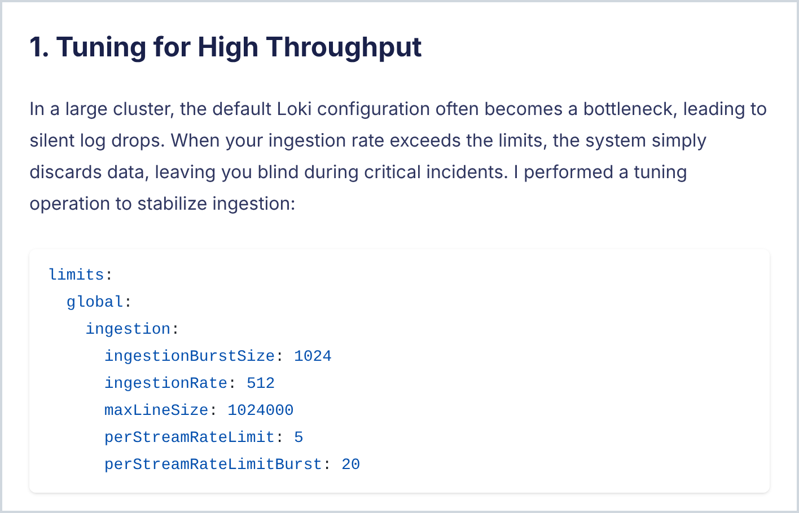

When I decided to build my own site on GitHub Pages, I already had a few articles published on Medium. Copying and pasting each one by hand was out of the question: code blocks lose their formatting, images get left behind and some detail always slips through. I wanted to bring everything over at once, as clean Markdown and with as little rework as possible.

In this article I show the path I took: Medium's official export and a small Python script, **medium2md**, that turns that export into posts ready for **Hugo** or **Jekyll**.

## Why keep your writing outside Medium?

- **Your content is yours**: as Markdown, versioned in Git, it doesn't depend on any platform.
- **Your own domain**: links point to your address, and the audience you build stays with you.
- **Freedom**: theme, languages, diagrams, layout... on your site, you call the shots.
- **Zero cost**: GitHub Pages hosts static sites for free.

Nothing stops you from keeping on publishing on Medium. The idea is to have your own home and bring what you have already written into it.

## First things first: no scraping

The first idea many people have is to scrape the Medium pages. That works until their HTML changes again, not to mention the bot blocking and the paywall. It isn't worth the effort, because Medium itself hands you everything you've written in a `.zip` file.

## Step 1: export your data from Medium

1. On Medium, click your profile picture and go to **Settings**.
2. Open the **Security and apps** tab.
3. Click **Download your information** and confirm with **Export**.
4. When the archive is ready, you get an e-mail with a link to download `medium-export.zip`.

The zip contains much more than your posts: profile, lists, reading history, sessions and even IP addresses. Keep this file somewhere safe and never put it in your site's repository. What matters here is the `posts` folder:

```text
medium-export/
├── posts/
│   ├── 2026-06-16_Taming-the-Chaos--Mastering-Log-Management-in-OpenShift-at-Scale-e14af3701206.html
│   ├── 2026-10-13_Local-AI-with-Podman-and-Fedora-44--...-d3c8ad3a18e3.html
│   └── draft_numCoresPerSocket-on-OpenShift--...-bd0e3ef554bc.html
├── profile/
├── lists/
├── reading-history/
└── ...
```

Each post becomes an HTML file. Published ones start with the date and drafts with `draft_`. The comments you left on other people's stories also show up in this folder, mixed with your posts.

## The problem: this HTML is not Markdown

You can open the files in a browser, but running a generic HTML-to-Markdown converter on them leaves you with a lot of cleanup. In my own posts alone I found:

- **Duplicated title**: it shows up in the header and again in the body.
- **Chopped-up code**: every line is broken with `<br>` and full of highlighting `<span>` tags.
- **Wrong language on code blocks**: Medium's auto-detection labeled shell commands as `typescript`, `cpp` and even `lua`, and the output of `lscpu` as `scss`.
- **Stray labels**: that "YAML" or "bash" that comes along when you paste code from somewhere else becomes a paragraph right before the block.
- **Dirty links**: tracking parameters like `?source=...` and even the sentence's final period inside the link.
- **Images on Medium's CDN**, not in your repository.
- **No tags at all**: the export simply doesn't include your posts' tags.
- **Automatic subtitle**: when you don't write one, Medium uses the first words of the text with "…" at the end.

Fixing this post by post is exactly the kind of repetitive work worth automating.

## Step 2: meet medium2md

**medium2md** is a single-file script that only uses Python's standard library. All you need is Python 3.9 or newer, which already ships with most Linux distributions and with macOS. It:

- reads the zip directly, no need to extract it, and picks only your posts, skipping the comments;
- writes one Markdown file per post with front matter (date, slug, title, description and tags);
- removes the duplicated title and uses your subtitle, or the first sentences of the text, as the `description`;
- rebuilds code blocks with the right language, merges blocks Medium split in two and drops the stray labels;
- downloads the images next to the post and keeps their captions;
- turns links between your own posts into internal site links;
- recognizes translations: if a Portuguese post links to its English version right at the top, the two become a single page in two languages;
- escapes anything that would break the build, such as Hugo shortcode syntax or Liquid's `{{ }}` inside code blocks.

To get it:

```bash
git clone https://github.com/mariorpn/medium2md.git
cd medium2md
```

## Step 3: convert

Always start with `--dry-run`, which shows what would be written without touching anything:

```bash
python3 medium2md.py ~/Downloads/medium-export.zip -o ~/my-site --dry-run
```

If everything looks right, run it for real. This is the command I used for my site, which is a bilingual Hugo site (Portuguese as the default language, plus English):

```bash
python3 medium2md.py ~/Downloads/medium-export.zip -o ~/mariorpn.github.io \
  --lang-codes pt=pt-br,en=en \
  --tz America/Sao_Paulo \
  --include-drafts \
  --tags tags.txt
```

What each option does:

- `-o`: your site's root. With Hugo, posts go to `content/posts/`.
- `--lang-codes pt=pt-br,en=en`: turns on multilingual mode. The script detects each post's language and writes `index.pt-br.md` or `index.en.md`, using your site's language codes. The first one in the list is the default language.
- `--tz`: the time zone for the dates in the front matter.
- `--include-drafts`: also brings your drafts, marked with `draft: true`. Hugo only publishes them once you switch to `false`.
- `--tags`: since the export has no tags, you provide them in a text file.

`tags.txt` has one line per post, using the ID at the end of the Medium URL (`.../taming-the-chaos-...-e14af3701206`):

```text
e14af3701206: openshift, logging, loki, observability
d3c8ad3a18e3: linux, fedora, podman, ollama, artificial intelligence
```

The output looks like this:

```text
write  [post, en] content/posts/20260616-taming-the-chaos-mastering-log-management-in-openshift-at-scale/index.en.md
write  [post, pt] content/posts/20260909-ia-local-com-podman-e-fedora-44-dominando-o-ollama-e-open-webui-com-igpu-amd-radeon-780m/index.pt-br.md
write  [post, en] content/posts/20260909-ia-local-com-podman-e-fedora-44-dominando-o-ollama-e-open-webui-com-igpu-amd-radeon-780m/index.en.md
write  [draft, en] content/posts/20261018-numcorespersocket-on-openshift-the-complete-guide-for-vsphere-7-and-8/index.en.md

4 file(s) written, 0 skipped.
```

Notice that the Ollama post, which I had published in both Portuguese and English, ended up in the same folder with both languages.

Each post becomes a Hugo *page bundle*, with the text and the images side by side:

```text
content/posts/20261018-numcorespersocket-on-openshift-the-complete-guide-for-vsphere-7-and-8/
├── index.en.md
├── img-01.png
├── img-02.png
└── ...
```

And the front matter already comes out in the format Hugo expects:

```yaml
---
date: '2026-06-16T16:57:31-03:00'
draft: false
slug: "taming-the-chaos-mastering-log-management-in-openshift-at-scale"
title: "Taming the Chaos: Mastering Log Management in OpenShift at Scale"
description: "Logs are the heartbeat of any system. They are the diary of your infrastructure, telling the story of what is happening under the hood."
tags: ["openshift", "logging", "loki", "observability"]
---
```

The result on the site, with the Blowfish theme:



### Using Jekyll?

Jekyll is GitHub Pages' default generator, and the script supports it too:

```bash
python3 medium2md.py ~/Downloads/medium-export.zip -o ~/my-jekyll-site --format jekyll
```

Posts go to `_posts/YYYY-MM-DD-slug.md`, drafts to `_drafts/` and images to `assets/images/posts/`. Jekyll support is still in beta: the output follows kramdown syntax, but it has been tested much less than the Hugo output.

Running the script again is safe, because files that already exist are skipped. If you want to overwrite them, use `--force`.

## Step 4: review, test and publish

Before publishing, run the site locally:

```bash
hugo server -D
```

`-D` includes drafts. Open `http://localhost:1313` and go through the posts. With Jekyll, the equivalent is `bundle exec jekyll serve --drafts`.

Take your time checking:

- **The description**: when a post had no subtitle, the script uses the first sentences of the text. Sometimes it's worth rewriting.
- **The tags**: adjust them in `tags.txt` before converting or directly in the front matter.
- **The content itself**: rereading old posts during the move is a great time to fix typos and outdated information.

Once everything is right, commit and push:

```bash
git add content/posts
git commit -m "Import posts from Medium"
git push
```

In my case, a GitHub Actions workflow builds the Hugo site and publishes it to GitHub Pages on every push to the `main` branch. With Jekyll, GitHub Pages takes care of the build itself.

## Gotchas I ran into

- **A post in only one language doesn't show up in the other**: on a multilingual Hugo site, each language has its own list of posts. My article about logs on OpenShift, which only existed in English, didn't appear on the Portuguese version of the site until I translated it.
- **Images**: the script downloads images from Medium's CDN. If a download fails, it keeps the original URL and warns you in the terminal, so the post still works and you can run it again later.
- **Keep the zip out of the repository**: it contains personal data, and your site only needs the generated Markdown.

## Conclusion

With the official export and a script, a migration that looked like a lot of work became a single command. The result is clean Markdown, versioned in Git and published on your own domain. From then on, every new post is just another file in the repository.

medium2md is on [GitHub](https://github.com/mariorpn/medium2md). If you use it and find a case it doesn't handle well, open an issue there!
