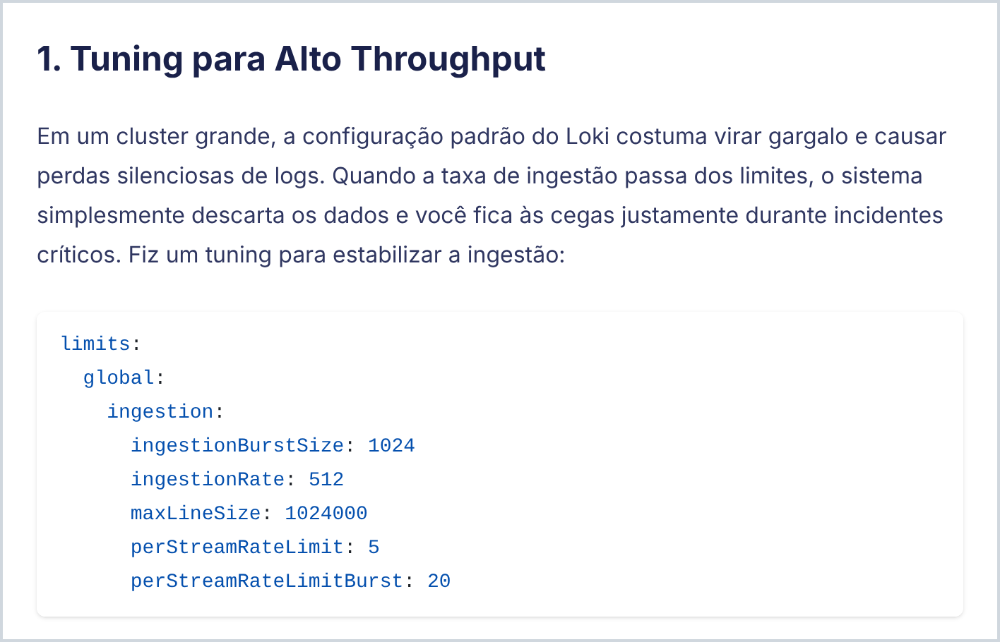

Quando decidi montar meu próprio site no GitHub Pages, eu já tinha alguns artigos publicados no Medium. Copiar e colar cada um à mão estava fora de cogitação: bloco de código perde a formatação, imagem fica para trás e sempre escapa algum detalhe. Eu queria trazer tudo de uma vez, em Markdown limpo e com o mínimo de retrabalho.

Neste artigo mostro o caminho que usei: o export oficial do Medium e um pequeno script Python, o **medium2md**, que transforma esse export em posts prontos para **Hugo** ou **Jekyll**.

## Por que ter seus textos fora do Medium?

- **O conteúdo é seu**: em Markdown e versionado no Git, ele não depende de nenhuma plataforma.
- **Domínio próprio**: os links apontam para o seu endereço, e a audiência que você constrói fica com você.
- **Liberdade**: tema, idiomas, diagramas, layout... no seu site, quem decide é você.
- **Custo zero**: o GitHub Pages hospeda sites estáticos de graça.

Nada impede de continuar publicando no Medium. A ideia é ter a sua casa e levar para ela o que você já escreveu.

## Antes de tudo: nada de scraping

A primeira ideia de muita gente é raspar as páginas do Medium. Isso funciona até a próxima mudança no HTML deles, sem contar o bloqueio a bots e o paywall. Não vale o esforço, porque o próprio Medium entrega tudo o que você escreveu num arquivo `.zip`.

## Passo 1: exporte seus dados do Medium

1. No Medium, clique na sua foto de perfil e vá em **Settings**.
2. Abra a aba **Security and apps**.
3. Clique em **Download your information** e confirme em **Export**.
4. Quando o arquivo fica pronto, chega um e-mail com o link para baixar o `medium-export.zip`.

O zip traz bem mais do que os posts: perfil, listas, histórico de leitura, sessões e até IPs. Guarde esse arquivo com cuidado e nunca o coloque no repositório do site. O que interessa aqui é a pasta `posts`:

```text
medium-export/
├── posts/
│   ├── 2026-06-16_Taming-the-Chaos--Mastering-Log-Management-in-OpenShift-at-Scale-e14af3701206.html
│   ├── 2026-09-09_IA-Local-com-Podman-e-Fedora-44--...-50d17c83f46a.html
│   └── draft_numCoresPerSocket-on-OpenShift--...-bd0e3ef554bc.html
├── profile/
├── lists/
├── reading-history/
└── ...
```

Cada post vira um arquivo HTML. Os publicados começam com a data e os rascunhos com `draft_`. Os comentários que você deixou em textos de outras pessoas também aparecem nessa pasta, misturados com os seus posts.

## O problema: esse HTML não é Markdown

Dá para abrir os arquivos no navegador, mas passar um conversor genérico de HTML para Markdown neles gera bastante retrabalho. Só nos meus posts eu encontrei:

- **Título duplicado**: ele aparece no cabeçalho e de novo no corpo do texto.
- **Código picotado**: cada linha vem quebrada com `<br>` e cheia de `<span>` de highlight.
- **Linguagem errada nos blocos de código**: a detecção automática do Medium marcou comandos de shell como `typescript`, `cpp` e até `lua`, e a saída de um `lscpu` como `scss`.
- **Rótulos soltos**: aquele "YAML" ou "bash" que vem junto quando você cola código de outro lugar vira um parágrafo antes do bloco.
- **Links sujos**: parâmetros de rastreamento como `?source=...` e até o ponto final da frase dentro do link.
- **Imagens no CDN do Medium**, e não no seu repositório.
- **Nenhuma tag**: o export simplesmente não traz as tags dos posts.
- **Subtítulo automático**: quando você não escreve um, o Medium usa as primeiras palavras do texto com "…" no final.

Resolver isso post a post é exatamente o tipo de trabalho repetitivo que vale automatizar.

## Passo 2: conheça o medium2md

O **medium2md** é um script de um arquivo só, que usa apenas a biblioteca padrão do Python. Basta ter Python 3.9 ou mais novo, que já vem na maioria das distribuições Linux e no macOS. Ele:

- lê o zip direto, sem precisar descompactar, e pega só os seus posts, ignorando os comentários;
- gera um Markdown por post com front matter (data, slug, título, descrição e tags);
- remove o título duplicado e usa o seu subtítulo, ou as primeiras frases do texto, como `description`;
- reconstrói os blocos de código com a linguagem certa, junta blocos que o Medium partiu em dois e descarta os rótulos soltos;
- baixa as imagens para junto do post e mantém as legendas;
- transforma links entre os seus próprios posts em links internos do site;
- reconhece traduções: se um post em português aponta logo no começo para a versão em inglês, os dois viram uma página só, com dois idiomas;
- escapa o que quebraria o build, como sintaxe de shortcode do Hugo ou `{{ }}` do Liquid dentro de blocos de código.

Para baixar:

```bash
git clone https://github.com/mariorpn/medium2md.git
cd medium2md
```

## Passo 3: converta

Comece sempre com `--dry-run`, que mostra o que seria gravado sem tocar em nada:

```bash
python3 medium2md.py ~/Downloads/medium-export.zip -o ~/meu-site --dry-run
```

Estando tudo certo, é só rodar de verdade. Este é o comando que usei no meu site, que é um Hugo bilíngue (português como idioma padrão, mais o inglês):

```bash
python3 medium2md.py ~/Downloads/medium-export.zip -o ~/mariorpn.github.io \
  --lang-codes pt=pt-br,en=en \
  --tz America/Sao_Paulo \
  --include-drafts \
  --tags tags.txt
```

O que cada opção faz:

- `-o`: a raiz do seu site. No Hugo, os posts vão para `content/posts/`.
- `--lang-codes pt=pt-br,en=en`: liga o modo multilíngue. O script detecta o idioma de cada post e grava `index.pt-br.md` ou `index.en.md`, com os códigos de idioma do seu site. O primeiro da lista é o idioma padrão.
- `--tz`: o fuso horário das datas no front matter.
- `--include-drafts`: traz também os rascunhos, marcados com `draft: true`. O Hugo só publica quando você muda para `false`.
- `--tags`: como o export não tem tags, você informa as tags num arquivo de texto.

O `tags.txt` tem uma linha por post, usando o ID que fica no fim da URL do Medium (`.../taming-the-chaos-...-e14af3701206`):

```text
e14af3701206: openshift, logging, loki, observability
50d17c83f46a: linux, fedora, podman, ollama, inteligência artificial
```

A saída fica assim:

```text
write  [post, en] content/posts/20260616-taming-the-chaos-mastering-log-management-in-openshift-at-scale/index.en.md
write  [post, pt] content/posts/20260909-ia-local-com-podman-e-fedora-44-dominando-o-ollama-e-open-webui-com-igpu-amd-radeon-780m/index.pt-br.md
write  [post, en] content/posts/20260909-ia-local-com-podman-e-fedora-44-dominando-o-ollama-e-open-webui-com-igpu-amd-radeon-780m/index.en.md
write  [draft, en] content/posts/20261018-numcorespersocket-on-openshift-the-complete-guide-for-vsphere-7-and-8/index.en.md

4 file(s) written, 0 skipped.
```

Repare que o post do Ollama, que eu tinha publicado em português e em inglês, foi parar na mesma pasta, com os dois idiomas.

Cada post vira um *page bundle* do Hugo, com o texto e as imagens lado a lado:

```text
content/posts/20261018-numcorespersocket-on-openshift-the-complete-guide-for-vsphere-7-and-8/
├── index.en.md
├── img-01.png
├── img-02.png
└── ...
```

E o front matter já sai no formato que o Hugo espera:

```yaml
---
date: '2026-06-16T16:57:31-03:00'
draft: false
slug: "taming-the-chaos-mastering-log-management-in-openshift-at-scale"
title: "Taming the Chaos: Mastering Log Management in OpenShift at Scale"
description: "Logs are the heartbeat of any system. They are the diary of your infrastructure, telling the story of what is happening under the hood."
tags: ["openshift", "logging", "loki", "observability"]
---
```

O resultado no site, com o tema Blowfish:



### Usa Jekyll?

O Jekyll é o gerador padrão do GitHub Pages, e o script também atende:

```bash
python3 medium2md.py ~/Downloads/medium-export.zip -o ~/meu-site-jekyll --format jekyll
```

Os posts vão para `_posts/AAAA-MM-DD-slug.md`, os rascunhos para `_drafts/` e as imagens para `assets/images/posts/`. O suporte a Jekyll ainda é beta: a saída segue a sintaxe do kramdown, mas foi bem menos testada que a do Hugo.

Rodar o script de novo é seguro, porque arquivos que já existem são pulados. Se quiser sobrescrever, use `--force`.

## Passo 4: revise, teste e publique

Antes de publicar, suba o site localmente:

```bash
hugo server -D
```

O `-D` inclui os rascunhos. Abra `http://localhost:1313` e passe pelos posts. No Jekyll, o equivalente é `bundle exec jekyll serve --drafts`.

Vale conferir com calma:

- **A descrição**: quando o post não tinha subtítulo, o script usa as primeiras frases do texto. Às vezes vale reescrever.
- **As tags**: ajuste no `tags.txt` antes de converter ou direto no front matter.
- **O próprio conteúdo**: reler os posts antigos durante a mudança é uma ótima hora para corrigir erros de digitação e informações desatualizadas.

Com tudo certo, é commit e push:

```bash
git add content/posts
git commit -m "Importa posts do Medium"
git push
```

No meu caso, um workflow do GitHub Actions faz o build do Hugo e publica no GitHub Pages a cada push na branch `main`. No Jekyll, o próprio GitHub Pages cuida do build.

## Pegadinhas que encontrei no caminho

- **Post em um idioma só não aparece no outro**: num site Hugo multilíngue, cada idioma tem a sua própria lista de posts. Meu artigo sobre logs no OpenShift, que só existia em inglês, não aparecia na versão em português do site até eu traduzi-lo.
- **Imagens**: o script baixa as imagens do CDN do Medium. Se o download falhar, ele mantém a URL original e avisa no terminal, então o post continua funcionando e você pode rodar de novo depois.
- **O zip fica fora do repositório**: ele tem dados pessoais, e o site só precisa dos Markdown gerados.

## Conclusão

Com o export oficial e um script, a migração que parecia trabalhosa virou um comando. O resultado é Markdown limpo, versionado no Git e publicado no seu domínio. A partir daí, cada post novo é só mais um arquivo no repositório.

O medium2md está no [GitHub](https://github.com/mariorpn/medium2md). Se você usar e encontrar algum caso que ele não trata bem, abre uma issue por lá!
