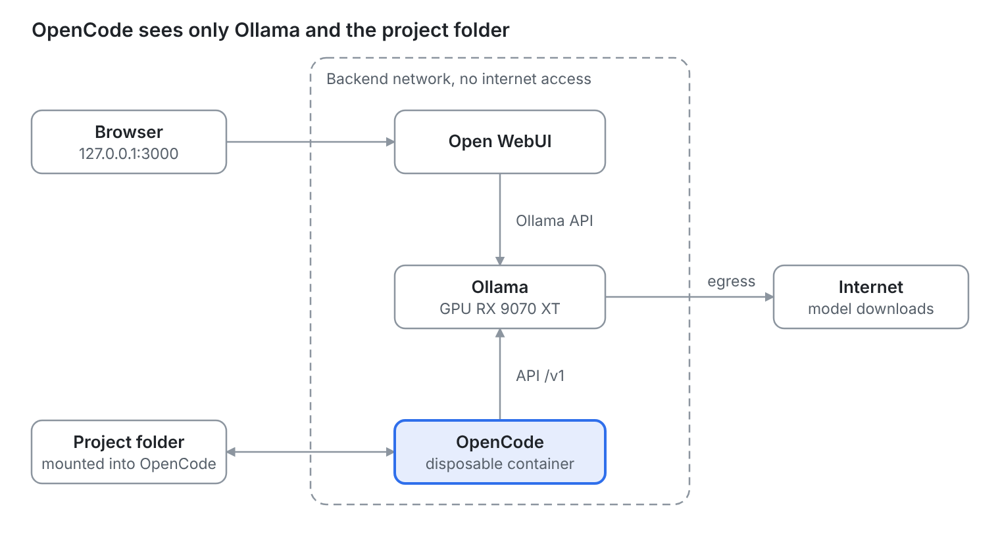

## Why build a hub of your own

Keeping all your LLM conversations in one place, running on your own machine, fixes three problems at once: scattered history, what leaves your computer, and the cost of several subscriptions.

I used to bounce between AIs in different tabs and apps, and every conversation stayed stuck in the service where it started. This article describes the setup I settled on: **Ollama** to run the models, **Open WebUI** as the chat interface, and **OpenCode** as a coding agent, all in containers with **rootless Podman** and a 16 GB **AMD RX 9070 XT**.

Running Ollama, Open WebUI and OpenCode in containers is also a decision about **security and control**. The container isolates each piece from the operating system it runs on and adds one more layer to keep the AI away from what it was not asked to touch, such as files outside the project, credentials or the network. It does not guarantee that nothing can happen, but it narrows the reach of a model mistake or a careless command.

Two caveats up front. The hub centralizes conversations going forward, but it does not import your old history from cloud services by itself. And local models in the 14B to 20B parameter range are useful day to day, but they make more mistakes on large tasks than cloud models do.

## How the pieces fit together



The browser talks only to Open WebUI, and Open WebUI and OpenCode talk only to Ollama, over the internal network. The `egress` network is used only by Ollama and Open WebUI, to download models; OpenCode, highlighted, has no way out to the internet and sees only the project folder.

## Choosing the pieces

Every layer of the hub has more than one good option. I picked the lowest-friction one for daily use and noted the alternatives.

| Layer | My pick | Alternatives | Why |
| --- | --- | --- | --- |
| Chat interface | Open WebUI | LibreChat, LobeChat, AnythingLLM | One container, and it finds Ollama on its own |
| Inference | Ollama | llama.cpp (`llama-server`), LM Studio | Handles model download, loading and unloading |
| Coding agent | OpenCode | Codex CLI, Aider, Goose, Crush | Works with 75+ providers and with local models |
| Runtime | Rootless Podman | Docker | Root inside the container maps to a regular user on the host |

Three notes on those choices:

- **Ollama or llama.cpp.** llama.cpp is the engine under Ollama and gives you more control, such as a quantized KV cache and partial offloading. In exchange, you manage the GGUF files yourself and run one model per server process. For daily use, Ollama's convenience won.
- **ROCm or Vulkan.** On an AMD card, Ollama can use either path, but it makes no sense to combine them on the same GPU. Performance reports disagree, so the right call is to measure on your own hardware.
- **OpenCode and subscriptions.** OpenCode does not accept a login from a Claude subscription. Using Claude models in it requires an API key billed per token. If you want to keep your subscription, Claude Code is still the better fit.

## Host prerequisites

Rootless Podman only sees the GPU if your user has permission on the devices and SELinux lets the container use them. Four one-time adjustments:

1. Add your user to the groups that guard the GPU devices, then log in again:

```bash
sudo usermod -aG render,video $USER
```

2. If SELinux is enabled, allow containers to use devices:

```bash
sudo setsebool -P container_use_devices on
```

3. Install `podman-compose` (the commands below use `dnf`; adapt them to your distribution):

```bash
sudo dnf install podman-compose
```

4. Make sure the driver is in place. Vulkan uses the standard driver (Mesa). The ROCm path needs the ROCm 7 driver on the host, according to [Ollama's GPU documentation](https://docs.ollama.com/gpu).

One detail that costs time: in rootless Podman, the container needs the special value `keep-groups` (`--group-add keep-groups`), which passes your user's real groups through. Passing `video` or `render` by name often fails, because the name is looked up inside the container, where those groups may not exist.

## Ollama and Open WebUI with compose

The compose file starts only Ollama and Open WebUI. OpenCode stays out on purpose, because it is interactive and runs on demand (next section). Two networks separate what may reach the outside from what may not: `backend`, with no internet access, and `egress`, used only to download models.

This is the **Vulkan** variant (`compose.vulkan.yml`):

```yaml
name: hub-llm

services:
  ollama:
    image: docker.io/ollama/ollama
    container_name: ollama
    restart: unless-stopped
    devices:
      - /dev/dri:/dev/dri
    group_add:
      - keep-groups
    environment:
      - OLLAMA_VULKAN=1
      - OLLAMA_CONTEXT_LENGTH=32768
      - OLLAMA_FLASH_ATTENTION=1
      - OLLAMA_KV_CACHE_TYPE=q8_0
      - OLLAMA_KEEP_ALIVE=10m
    volumes:
      - ollama:/root/.ollama
    networks: [backend, egress]

  openwebui:
    image: ghcr.io/open-webui/open-webui:main
    container_name: openwebui
    restart: unless-stopped
    depends_on:
      - ollama
    ports:
      - "127.0.0.1:3000:8080"
    environment:
      - OLLAMA_BASE_URL=http://ollama:11434
      - ENABLE_SIGNUP=${ENABLE_SIGNUP:-true}
    volumes:
      - openwebui:/app/backend/data
    networks: [backend, egress]

networks:
  backend:
    name: hub-llm-backend
    internal: true
  egress:
    name: hub-llm-egress

volumes:
  ollama:
  openwebui:
```

The **ROCm** variant (`compose.rocm.yml`) changes only the `ollama` service: the image becomes `docker.io/ollama/ollama:rocm`, the `/dev/kfd:/dev/kfd` device is added next to `/dev/dri`, and `OLLAMA_VULKAN=1` goes away. Keep only one of the two files up at a time; the volumes are shared, so you can switch back and forth without downloading the models again.

To start everything and pull a model:

```bash
podman-compose -f compose.vulkan.yml up -d
podman exec -it ollama ollama pull qwen3:14b
```

The interface lives at `http://127.0.0.1:3000`. The port is published on the loopback address only, on purpose. On first visit you create the administrator account; after that, set `ENABLE_SIGNUP=false` and bring the stack up again to close registration.

To confirm the GPU is in use, run `podman exec ollama ollama ps` and check that the `PROCESSOR` column says GPU.

## Isolating OpenCode

OpenCode is the only component that runs commands and changes files, so that is where isolation matters. The rule is simple: it sees the project folder, its own configuration and Ollama, and nothing else.

I used the image published by the project itself, `ghcr.io/anomalyco/opencode`. Inspecting it, I found that it runs as root (with `HOME=/root`), ships `rg`, and does not ship `git`. The [missing git in the image](https://github.com/anomalyco/opencode/issues/27743) is a known issue, and OpenCode features such as identifying the project and tracking changes depend on it. Because the container has no internet access, git has to go into the image itself. A three-line `Containerfile` does it:

```dockerfile
ARG OPENCODE_TAG=latest
FROM ghcr.io/anomalyco/opencode:${OPENCODE_TAG}

RUN apk add --no-cache git \
    && git config --system --add safe.directory /workspace
```

Pin a version instead of `latest`. An agent with access to your project should not change behavior without notice.

Running it is a `podman run` with the essentials for isolation:

```bash
podman run --rm -it \
  --network hub-llm-backend \
  --cap-drop=ALL \
  --security-opt no-new-privileges \
  --memory 4g --pids-limit 512 \
  -w /workspace \
  -v "$PROJECT_DIR":/workspace:Z \
  -v ~/.config/hub-llm/opencode.json:/etc/opencode/opencode.json:ro,z \
  -e OPENCODE_CONFIG=/etc/opencode/opencode.json \
  -v opencode-data:/root/.local/share/opencode \
  -v opencode-cache:/root/.cache/opencode \
  localhost/opencode-hub:<tag>
```

What each part does:

- `--network hub-llm-backend`: the internal network, with no way out to the internet. The container can only reach Ollama.
- `--cap-drop=ALL` and `no-new-privileges`: no extra capabilities and no privilege escalation.
- `:Z`: SELinux relabels the project folder for the container. Use dedicated project folders, because everything inside the mounted folder gets relabeled.
- No `--userns=keep-id`: the image runs as root, and in rootless Podman the container's root maps to your user on the host. Files the agent creates remain yours.
- `OPENCODE_CONFIG`: points to the config file explicitly. OpenCode finds `opencode.json` even if the image's `$HOME` changes, instead of relying on `/root/.config/opencode/`.

I wrapped all of this in a script called `opencode`, placed in `~/.local/bin`. With no arguments it opens in the current folder; with a path, it opens there. Since it is easy to open the wrong folder, the script also refuses `$HOME`, system folders and credential folders (`.ssh`, `.kube`, `.aws` and similar), and asks for confirmation when the folder is not the root of a git repository. The script, the `Containerfile` and `opencode.json` live in `~/.config/hub-llm/`.

## Pointing OpenCode at Ollama

The `opencode.json` file declares Ollama as an OpenAI-compatible provider and picks the default model:

```json
{
  "$schema": "https://opencode.ai/config.json",
  "model": "ollama/qwen3:14b",
  "share": "disabled",
  "autoupdate": false,
  "permission": {
    "edit": "allow",
    "bash": "ask"
  },
  "provider": {
    "ollama": {
      "npm": "@ai-sdk/openai-compatible",
      "name": "Ollama (container)",
      "options": {
        "baseURL": "http://ollama:11434/v1"
      },
      "models": {
        "qwen3:14b": {
          "name": "Qwen3 14B",
          "limit": { "context": 32768, "output": 8192 }
        },
        "gpt-oss:20b": {
          "name": "gpt-oss 20B",
          "limit": { "context": 32768, "output": 8192 }
        }
      }
    }
  }
}
```

A few points deserve attention:

- Model names must match the output of `ollama list` exactly.
- `limit.context` should follow the `OLLAMA_CONTEXT_LENGTH` set in the compose file. Ollama's default is usually too small for a coding agent.
- `share: disabled` prevents public conversation links, and `autoupdate: false` makes sense in a container with no internet.
- With `bash: ask`, every shell command asks for confirmation. If that is too much, switch it to `allow`: the container is isolated and the project is under git.
- OpenCode's configuration schema changes between versions. If a key is rejected, the error message at startup tells you which one.

## Skills, plugins and online mode

OpenCode runs without internet day to day, but some extensions need it. The way out is to separate what is just files from what needs a download.

- **Skills** are folders with a `SKILL.md` and need no network. Download them on the host, read them, and put them in `~/.config/hub-llm/skills/`. The script mounts that folder, read-only, at `/root/.config/opencode/skills/`. Project-specific skills can live in `.opencode/skills/` inside the repository.
- **Local plugins** (`.js` or `.ts` files) work the same way, in `~/.config/hub-llm/plugins/`.
- **npm plugins**, declared under the `"plugin"` key in `opencode.json`, are installed by OpenCode with Bun at startup and cached in `~/.cache/opencode/node_modules/`. That path is the `opencode-cache` volume, so internet is needed only once.

For that last case, the script has an online mode. It asks for confirmation and applies to that session only:

```bash
OPENCODE_ONLINE=1 opencode
```

In this mode the container also joins the `hub-llm-egress` network. Install the plugin, exit, and go back to plain `opencode`: the plugin stays in the cache and works offline.

Why not stay online all the time? A local model does not remove the risk, because the agent is what runs commands. With internet, a prompt injection hidden in a README or a dependency can lead the agent to send the folder's contents out, and 14B to 20B models fall for that kind of trick more easily. Without a network, the worst case is a broken folder, and git rolls it back. With a network, the worst case is a leaked folder, and there is no undo for that.

## Pitfalls I hit

Nearly every stumble came from the differences between Docker and rootless Podman. Here are the main ones, so you do not have to repeat the trip.

| Symptom | Cause | Fix |
| --- | --- | --- |
| `Unable to find group keep-groups` when bringing up compose | `docker-compose` was talking to the Podman socket, and the compatibility API treats `keep-groups` as a regular group | Use `podman-compose`, or force it with `PODMAN_COMPOSE_PROVIDER=podman-compose` |
| Container has no GPU access, or a missing-group error | `group_add` with `video` and `render` by name in rootless mode | Use `keep-groups` and add your user to the groups on the host |
| `Containerfile.opencode: no such file or directory` | The script was moved to `/usr/local/bin` without its support files | Look for the files in `~/.config/hub-llm/` |
| No git inside the container | The official image does not include git | A derived image with `apk add git` |
| Cannot create the first Open WebUI account | `ENABLE_SIGNUP=false` from the start blocks the admin signup | Start with `true` and close it afterward |
| Ollama models missing from OpenCode's `/models` list; only the free OpenCode Zen models show | The `opencode.json` was mounted where OpenCode never looks: an older script used `/home/node/.config/opencode/`, but the official image uses `HOME=/root` | Mount it at `/etc/opencode/opencode.json` and pass `-e OPENCODE_CONFIG=/etc/opencode/opencode.json`. To check: `opencode debug config` |
| The `ollama` provider disappears with no clear error | Invalid JSON in `opencode.json`, such as a missing `}` at the end of each model | Validate before use: `python3 -m json.tool opencode.json` |

One more point of attention: if OpenCode needs to download a package on first run, such as the provider package or a plugin, use `OPENCODE_ONLINE=1` just that once. Whatever gets installed stays in the cache volume, and later sessions run without internet again.

If you use SELinux, remember the `:Z` on bind mounts and the `container_use_devices` boolean. Without them, permission problems show up as a bare "permission denied" with little to go on.

## Models for 16 GB of VRAM

With 16 GB, the starting point is models from 14B to 20B parameters, which fit entirely on the GPU. Two that I use as a base: `qwen3:14b` and `gpt-oss:20b`.

Larger models, such as the 30B variants, tend to exceed the VRAM and spill partly into system RAM. The result works, but it is much slower. 
Three habits help keep everything on the GPU:

- **Context.** The larger the context, the larger the KV cache. If VRAM runs short, lower `OLLAMA_CONTEXT_LENGTH` before switching models.
- **Quantized KV cache.** `OLLAMA_KV_CACHE_TYPE=q8_0`, which requires `OLLAMA_FLASH_ATTENTION=1`, shrinks the space the context takes.
- **Measurement.** Run the same prompt on each backend and compare the generation rate:

```bash
podman exec -it ollama ollama run --verbose qwen3:14b "explain what an operator is in OpenShift"
```

The `eval rate` field at the end shows tokens per second. Discard the first run, which includes loading the model. This is how you choose between ROCm and Vulkan on your own machine, instead of trusting third-party numbers.

A realistic expectation for the coding agent: local models in this range handle small and medium tasks, such as explaining a repository, writing tests and making targeted edits. On large changes and long chains of tool calls, they make more mistakes than cloud models. Start with short, specific requests, use the agent's plan mode (the Tab key) when you are unsure what it will do, and commit before every session.

## Security, limits and next steps

Isolation lowers the risk but does not remove it. The limits I keep in mind:

- **A container is not a virtual machine.** It shares the host kernel. Rootless Podman helps, because an escape lands in an unprivileged user, but for stronger isolation consider running the whole stack inside a dedicated VM.
- **The mounted folder is read and changed by the agent.** Keep secrets out of it and commit before every session so you can roll back.
- **The Open WebUI port stays on `127.0.0.1` only.** To reach it from another machine, prefer an SSH tunnel (`ssh -L 3000:127.0.0.1:3000 user@host`) over opening the port on the network.
- **Open WebUI's code execution and tool features.** If you do not use them, leave them off.
- **Local models have quality limits.** For heavy work, the hub coexists well with cloud providers. The safest route is a gateway such as [LiteLLM](https://github.com/BerriAI/litellm), attached to both the `backend` and `egress` networks: OpenCode stays offline and talks only to the gateway, and the API keys stay outside the agent's container. Even so, whatever part of the project folder enters the context goes to the provider.

Possible next steps: try `llama.cpp` with Vulkan in place of Ollama to gain control over VRAM, and convert the files to **Quadlet** so systemd manages the containers and they come up with the system.

The practical result is a single place to talk to models and to code with an agent, running on my own machine, with the agent confined to the project folder. The complete files (compose, `Containerfile`, script and `opencode.json`) are short and reproducible.

## Files

The files used in this post, ready to download:

- [`compose.vulkan.yml`](compose.vulkan.yml): Ollama (Vulkan) and Open WebUI
- [`compose.rocm.yml`](compose.rocm.yml): Ollama (ROCm) and Open WebUI
- [`Containerfile.opencode`](Containerfile.opencode): the official OpenCode image plus git
- [`run-opencode.sh`](run-opencode.sh): the `opencode` script, with online mode
- [`opencode.json`](opencode.json): OpenCode config pointing at Ollama

## Sources

- [Ollama: Docker documentation](https://docs.ollama.com/docker)
- [Ollama: GPU selection and support](https://docs.ollama.com/gpu)
- [Red Hat: Podman with AMD ROCm accelerators and SELinux](https://docs.redhat.com/ja/documentation/red_hat_ai_inference_server/3.2/html/getting_started/inference-rhaiis-with-podman-amd-rocm_getting-started)
- [Running AMD GPU containers with Podman (keep-groups)](https://oneuptime.com/blog/post/2026-03-18-run-amd-gpu-containers-podman/markdown)
- [Podman troubleshooting guide (SELinux, `:Z`, `keep-id`)](https://github.com/containers/podman/blob/main/troubleshooting.md)
- [OpenCode: project repository](https://github.com/anomalyco/opencode)
- [OpenCode: issue about the missing git in the image](https://github.com/anomalyco/opencode/issues/27743)
