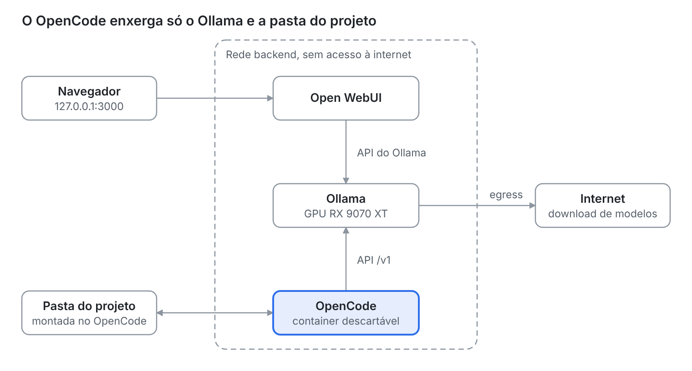

## Por que montar um hub próprio

Concentrar as conversas com LLMs em um único lugar, rodando na sua máquina, resolve três problemas de uma vez: o histórico espalhado, o que sai do seu computador e o custo de várias assinaturas.

Eu usava várias IAs em abas e aplicativos diferentes, e cada conversa ficava presa no serviço onde nasceu. Este artigo descreve a montagem que adotei: **Ollama** para rodar os modelos, **Open WebUI** como interface de chat e **OpenCode** como agente de código, tudo em containers com **Podman rootless** e uma placa **AMD RX 9070 XT** de 16 GB.

Rodar o Ollama, o Open WebUI e o OpenCode em containers também é uma decisão de **segurança e controle**. O container isola cada peça do sistema operacional em que ela roda e cria mais uma camada para evitar que a IA acesse o que não foi pedido, como arquivos fora do projeto, credenciais ou a rede. Isso não garante que nada aconteça, mas reduz o alcance de um erro do modelo ou de um comando mal pensado.

Duas ressalvas desde já. O hub centraliza as conversas daqui para a frente, mas não importa sozinho o histórico antigo dos serviços de nuvem. E modelos locais de 14B a 20B parâmetros são úteis no dia a dia, mas erram mais em tarefas grandes do que os modelos de nuvem.

## Como as peças se encaixam



O navegador só fala com o Open WebUI, e o Open WebUI e o OpenCode só falam com o Ollama, pela rede interna. A rede `egress` é usada apenas pelo Ollama e pelo Open WebUI, para baixar modelos; o OpenCode, em destaque, não tem saída para a internet e só enxerga a pasta do projeto.

## Escolhendo as peças

Cada camada do hub tem mais de uma boa opção. Escolhi a de menor atrito para o dia a dia e deixei as alternativas anotadas.

| Camada | Minha escolha | Alternativas | Motivo |
| --- | --- | --- | --- |
| Interface de chat | Open WebUI | LibreChat, LobeChat, AnythingLLM | Sobe com um único container e encontra o Ollama sozinho |
| Inferência | Ollama | llama.cpp (`llama-server`), LM Studio | Gerencia download, carga e descarga dos modelos |
| Agente de código | OpenCode | Codex CLI, Aider, Goose, Crush | Funciona com mais de 75 provedores e com modelos locais |
| Execução | Podman rootless | Docker | O root do container vira um usuário comum no host |

Três observações sobre essas escolhas:

- **Ollama ou llama.cpp.** O llama.cpp é o motor por baixo do Ollama e dá mais controle, como cache KV quantizado e offload de partes do modelo. Em troca, você gerencia os arquivos GGUF e sobe um modelo por processo. Para o uso diário, a praticidade do Ollama pesou mais.
- **ROCm ou Vulkan.** No Ollama, uma placa AMD pode usar os dois caminhos, mas não faz sentido combiná-los para a mesma GPU. Os relatos de desempenho divergem, então a decisão certa é medir no seu hardware.
- **OpenCode e assinaturas.** O OpenCode não aceita login com uma assinatura do Claude. Para usar modelos Claude nele, é preciso chave de API com cobrança por token. Quem quer manter a assinatura continua melhor servido pelo Claude Code.

## Pré-requisitos no host

O Podman rootless só enxerga a GPU se o seu usuário tiver permissão nos dispositivos e se o SELinux deixar o container usá-los. Quatro ajustes, feitos uma única vez:

1. Coloque seu usuário nos grupos que protegem os dispositivos da GPU e faça login de novo:

```bash
sudo usermod -aG render,video $USER
```

2. Se o SELinux estiver ativo, permita que containers usem dispositivos:

```bash
sudo setsebool -P container_use_devices on
```

3. Instale o `podman-compose` (os comandos abaixo usam `dnf`; adapte à sua distribuição):

```bash
sudo dnf install podman-compose
```

4. Garanta o driver. O Vulkan usa o driver padrão (Mesa). O caminho ROCm exige o driver ROCm 7 no host, segundo a [documentação de GPU do Ollama](https://docs.ollama.com/gpu).

Um detalhe que custa tempo: no Podman rootless, o container precisa do valor especial `keep-groups` (`--group-add keep-groups`), que repassa os grupos reais do seu usuário. Passar `video` ou `render` pelo nome costuma falhar, porque o nome é procurado dentro do container, onde esses grupos podem não existir.

## Ollama e Open WebUI com compose

O compose sobe só o Ollama e o Open WebUI. O OpenCode fica fora de propósito, porque ele é interativo e roda sob demanda (próxima seção). Duas redes separam o que pode sair do que não pode: `backend`, sem acesso à internet, e `egress`, usada apenas para baixar modelos.

Esta é a variante com **Vulkan** (`compose.vulkan.yml`):

```yaml
name: hub-llm

services:
  ollama:
    image: docker.io/ollama/ollama
    container_name: ollama
    restart: unless-stopped
    devices:
      - /dev/dri:/dev/dri
    group_add:
      - keep-groups
    environment:
      - OLLAMA_VULKAN=1
      - OLLAMA_CONTEXT_LENGTH=32768
      - OLLAMA_FLASH_ATTENTION=1
      - OLLAMA_KV_CACHE_TYPE=q8_0
      - OLLAMA_KEEP_ALIVE=10m
    volumes:
      - ollama:/root/.ollama
    networks: [backend, egress]

  openwebui:
    image: ghcr.io/open-webui/open-webui:main
    container_name: openwebui
    restart: unless-stopped
    depends_on:
      - ollama
    ports:
      - "127.0.0.1:3000:8080"
    environment:
      - OLLAMA_BASE_URL=http://ollama:11434
      - ENABLE_SIGNUP=${ENABLE_SIGNUP:-true}
    volumes:
      - openwebui:/app/backend/data
    networks: [backend, egress]

networks:
  backend:
    name: hub-llm-backend
    internal: true
  egress:
    name: hub-llm-egress

volumes:
  ollama:
  openwebui:
```

A variante com **ROCm** (`compose.rocm.yml`) muda apenas o serviço `ollama`: a imagem passa a ser `docker.io/ollama/ollama:rocm`, o dispositivo `/dev/kfd:/dev/kfd` é adicionado ao lado de `/dev/dri`, e a variável `OLLAMA_VULKAN=1` sai. Mantenha só um dos dois arquivos de pé por vez; os volumes são os mesmos, então dá para alternar sem baixar os modelos de novo.

Para subir e baixar um modelo:

```bash
podman-compose -f compose.vulkan.yml up -d
podman exec -it ollama ollama pull qwen3:14b
```

A interface fica em `http://127.0.0.1:3000`. A porta é publicada só no endereço local, de propósito. No primeiro acesso você cria a conta de administrador; depois, defina `ENABLE_SIGNUP=false` e suba o compose de novo para fechar o cadastro.

Para confirmar que a GPU está em uso, rode `podman exec ollama ollama ps` e veja se a coluna `PROCESSOR` mostra GPU.

## Isolando o OpenCode

O OpenCode é o único componente que executa comandos e altera arquivos, então é nele que o isolamento importa. A regra é simples: ele enxerga a pasta do projeto, a sua configuração e o Ollama, e mais nada.

Usei a imagem publicada pelo próprio projeto, `ghcr.io/anomalyco/opencode`. Ao inspecionar a imagem, vi que ela roda como root (com `HOME=/root`), traz o `rg` e não traz o `git`. A [falta do git na imagem](https://github.com/anomalyco/opencode/issues/27743) é um problema conhecido, e recursos do OpenCode, como identificar o projeto e acompanhar alterações, dependem dele. Como o container não tem internet, o git precisa entrar na própria imagem. Um `Containerfile` de três linhas resolve:

```dockerfile
ARG OPENCODE_TAG=latest
FROM ghcr.io/anomalyco/opencode:${OPENCODE_TAG}

RUN apk add --no-cache git \
    && git config --system --add safe.directory /workspace
```

Fixe uma versão no lugar de `latest`. Um agente com acesso ao seu projeto não deve mudar de comportamento sem aviso.

A execução é um `podman run` com o essencial para isolar:

```bash
podman run --rm -it \
  --network hub-llm-backend \
  --cap-drop=ALL \
  --security-opt no-new-privileges \
  --memory 4g --pids-limit 512 \
  -w /workspace \
  -v "$PROJECT_DIR":/workspace:Z \
  -v ~/.config/hub-llm/opencode.json:/etc/opencode/opencode.json:ro,z \
  -e OPENCODE_CONFIG=/etc/opencode/opencode.json \
  -v opencode-data:/root/.local/share/opencode \
  -v opencode-cache:/root/.cache/opencode \
  localhost/opencode-hub:<tag>
```

O que cada parte faz:

- `--network hub-llm-backend`: a rede interna, sem saída para a internet. O container só alcança o Ollama.
- `--cap-drop=ALL` e `no-new-privileges`: sem capacidades extras e sem escalonamento de privilégio.
- `:Z`: o SELinux reetiqueta a pasta do projeto para o container. Use pastas de projeto dedicadas, porque tudo dentro da pasta montada é reetiquetado.
- Sem `--userns=keep-id`: a imagem roda como root, e no Podman rootless o root do container corresponde ao seu usuário no host. Os arquivos que o agente cria continuam sendo seus.
- `OPENCODE_CONFIG`: aponta o arquivo de configuração de forma explícita. Assim o OpenCode encontra o `opencode.json` mesmo que o `$HOME` da imagem mude, em vez de depender de `/root/.config/opencode/`.

Eu embrulhei isso em um script chamado `opencode`, colocado em `~/.local/bin`. Sem argumentos, ele abre na pasta atual; com um caminho, abre naquela pasta. Como é fácil abrir na pasta errada, o script também recusa a `$HOME`, pastas de sistema e pastas de credenciais (`.ssh`, `.kube`, `.aws` e similares), e pede confirmação quando a pasta não é a raiz de um repositório git. O script, o `Containerfile` e o `opencode.json` ficam em `~/.config/hub-llm/`.

## Apontando o OpenCode para o Ollama

O arquivo `opencode.json` declara o Ollama como um provedor compatível com a API da OpenAI e escolhe o modelo padrão:

```json
{
  "$schema": "https://opencode.ai/config.json",
  "model": "ollama/qwen3:14b",
  "share": "disabled",
  "autoupdate": false,
  "permission": {
    "edit": "allow",
    "bash": "ask"
  },
  "provider": {
    "ollama": {
      "npm": "@ai-sdk/openai-compatible",
      "name": "Ollama (container)",
      "options": {
        "baseURL": "http://ollama:11434/v1"
      },
      "models": {
        "qwen3:14b": {
          "name": "Qwen3 14B",
          "limit": { "context": 32768, "output": 8192 }
        },
        "gpt-oss:20b": {
          "name": "gpt-oss 20B",
          "limit": { "context": 32768, "output": 8192 }
        }
      }
    }
  }
}
```

Pontos que merecem atenção:

- Os nomes dos modelos precisam ser idênticos aos de `ollama list`.
- O `limit.context` deve acompanhar o `OLLAMA_CONTEXT_LENGTH` do compose. O padrão do Ollama costuma ser pequeno demais para um agente de código.
- `share: disabled` impede a criação de links públicos de conversa, e `autoupdate: false` faz sentido num container sem internet.
- Com `bash: ask`, cada comando de shell pede confirmação. Se achar demais, mude para `allow`: o container é isolado e o projeto está no git.
- O esquema de configuração do OpenCode muda entre versões. Se uma chave for rejeitada, a mensagem de erro na abertura indica qual.

## Skills, plugins e o modo online

O OpenCode fica sem internet no dia a dia, mas algumas extensões precisam dela. A saída é separar o que é só arquivo do que precisa de download.

- **Skills** são pastas com um `SKILL.md` e não precisam de rede. Baixe no host, leia o conteúdo e coloque em `~/.config/hub-llm/skills/`. O script monta essa pasta, somente leitura, em `/root/.config/opencode/skills/`. Skills de um projeto específico podem ficar em `.opencode/skills/` dentro do repositório.
- **Plugins locais** (arquivos `.js` ou `.ts`) seguem o mesmo caminho, em `~/.config/hub-llm/plugins/`.
- **Plugins npm**, declarados na chave `"plugin"` do `opencode.json`, são instalados pelo OpenCode com Bun na inicialização e ficam em `~/.cache/opencode/node_modules/`. Esse caminho é o volume `opencode-cache`, então basta ter internet uma vez.

Para esse último caso, o script tem um modo online. Ele pede confirmação e vale só para aquela sessão:

```bash
OPENCODE_ONLINE=1 opencode
```

Nesse modo o container entra também na rede `hub-llm-egress`. Instale o plugin, saia e volte a usar só `opencode`: o plugin continua no cache e funciona offline.

Por que não deixar online sempre? Usar um modelo local não elimina o risco, porque quem executa comandos é o agente. Com internet, um prompt injection escondido num README ou numa dependência pode levar o agente a enviar o conteúdo da pasta para fora, e modelos de 14B a 20B caem nesse tipo de truque com mais facilidade. Sem rede, o pior caso é estragar a pasta, e o git reverte. Com rede, o pior caso é vazar a pasta, e isso não tem volta.

## Problemas que encontrei

Quase todos os tropeços vieram da diferença entre Docker e Podman rootless. 
Registrrei os principais para você não repetir mesmo caminho quue segui.

| Sintoma | Causa | Solução |
| --- | --- | --- |
| `Unable to find group keep-groups` ao subir o compose | O `docker-compose` estava falando com o socket do Podman, e a API de compatibilidade trata `keep-groups` como um grupo comum | Usar o `podman-compose`, ou forçar com `PODMAN_COMPOSE_PROVIDER=podman-compose` |
| Container sem acesso à GPU, ou erro de grupo inexistente | `group_add` com `video` e `render` pelo nome no rootless | Usar `keep-groups` e colocar o usuário nos grupos do host |
| `Containerfile.opencode: no such file or directory` | O script foi movido para `/usr/local/bin` sem os arquivos de apoio | Procurar os arquivos em `~/.config/hub-llm/` |
| Sem git dentro do container | A imagem oficial não inclui o git | Imagem derivada com `apk add git` |
| Não consigo criar a primeira conta no Open WebUI | `ENABLE_SIGNUP=false` desde o início bloqueia o cadastro do administrador | Começar com `true` e fechar depois |
| Os modelos do Ollama não aparecem no `/models` do OpenCode, só os gratuitos do OpenCode Zen | O `opencode.json` foi montado num caminho que o OpenCode não lê: o script antigo usava `/home/node/.config/opencode/`, mas a imagem oficial usa `HOME=/root` | Montar em `/etc/opencode/opencode.json` e passar `-e OPENCODE_CONFIG=/etc/opencode/opencode.json`. Para conferir: `opencode debug config` |
| O provider `ollama` some sem mensagem de erro clara | JSON inválido no `opencode.json`, como uma `}` faltando ao fim de cada modelo | Validar antes de usar: `python3 -m json.tool opencode.json` |

Um ponto extra de atenção: se o OpenCode precisar baixar algum pacote na primeira execução, como o do provedor ou um plugin, use o modo `OPENCODE_ONLINE=1` só nessa vez. O que for instalado fica no volume de cache, e as próximas sessões voltam a rodar sem internet.

Para quem usa SELinux, vale lembrar o `:Z` nos bind mounts e o booleano `container_use_devices`. Sem eles, os erros de permissão aparecem como "permission denied" sem muita pista.

## Modelos para 16 GB de VRAM

Com 16 GB, o ponto de partida são modelos de 14B a 20B parâmetros, que cabem inteiros na GPU. Dois que uso como base: `qwen3:14b` e `gpt-oss:20b`.

Modelos maiores, como as variantes de 30B, tendem a exceder a VRAM e a ir parcialmente para a RAM. O resultado funciona, mas fica bem mais lento. 
Três cuidados ajudam a manter tudo na GPU:

- **Contexto.** Quanto maior o contexto, maior o cache KV. Se faltar VRAM, reduza `OLLAMA_CONTEXT_LENGTH` antes de trocar de modelo.
- **Cache KV quantizado.** `OLLAMA_KV_CACHE_TYPE=q8_0`, que exige `OLLAMA_FLASH_ATTENTION=1`, reduz o espaço ocupado pelo contexto.
- **Medição.** Rode o mesmo prompt em cada backend e compare a taxa de geração:

```bash
podman exec -it ollama ollama run --verbose qwen3:14b "explique o que é um operator no OpenShift"
```

O campo `eval rate` no final mostra os tokens por segundo. Descarte a primeira execução, que inclui o carregamento do modelo. É assim que se decide entre ROCm e Vulkan na sua máquina, em vez de confiar em números de terceiros.

Uma expectativa realista para o agente de código: modelos locais dessa faixa dão conta de tarefas pequenas e médias, como explicar um repositório, escrever testes e fazer ajustes localizados. Em mudanças grandes e no uso encadeado de ferramentas, eles erram mais do que os modelos de nuvem. Comece com pedidos curtos e específicos, use o agente em modo de plano (tecla Tab) quando não tiver certeza do que ele vai fazer e faça commit antes de cada sessão.

## Segurança, limites e próximos passos

O isolamento reduz o risco, mas não o elimina. Os limites que eu tenho em mente:

- **Container não é máquina virtual.** Ele compartilha o kernel do host. O Podman rootless ajuda, porque um escape cai em um usuário sem privilégios, mas para um isolamento mais forte considere rodar tudo em uma VM dedicada.
- **A pasta montada é lida e alterada pelo agente.** Mantenha segredos fora dela e faça commit antes de cada sessão para poder reverter.
- **A porta do Open WebUI fica só em `127.0.0.1`.** Para acessar de outra máquina, prefira um túnel SSH (`ssh -L 3000:127.0.0.1:3000 usuario@host`) a abrir a porta na rede.
- **Recursos de execução de código e ferramentas do Open WebUI.** Se não for usar, deixe desligados.
- **Modelos locais têm limites de qualidade.** Para trabalho pesado, o hub convive bem com provedores de nuvem. O caminho mais seguro é um gateway como o [LiteLLM](https://github.com/BerriAI/litellm), ligado às redes `backend` e `egress`: o OpenCode continua sem internet e fala só com o gateway, e as chaves de API ficam fora do container do agente. Mesmo assim, o conteúdo da pasta do projeto que entra no contexto vai para o provedor.

Próximos passos possíveis: testar o `llama.cpp` com Vulkan no lugar do Ollama para ganhar controle sobre a VRAM, e converter os arquivos para **Quadlet**, para que o systemd gerencie os containers e eles subam junto com o sistema.

O resultado prático é um lugar único para conversar com modelos e programar com um agente, rodando na minha máquina, com o agente confinado à pasta do projeto. Os arquivos completos (compose, `Containerfile`, script e `opencode.json`) são curtos e reproduzíveis.

## Arquivos

Os arquivos usados neste post, prontos para baixar:

- [`compose.vulkan.yml`](compose.vulkan.yml): Ollama (Vulkan) e Open WebUI
- [`compose.rocm.yml`](compose.rocm.yml): Ollama (ROCm) e Open WebUI
- [`Containerfile.opencode`](Containerfile.opencode): imagem oficial do OpenCode com git
- [`run-opencode.sh`](run-opencode.sh): o script `opencode`, com o modo online
- [`opencode.json`](opencode.json): configuração do OpenCode apontando para o Ollama

## Fontes

- [Ollama: documentação de Docker](https://docs.ollama.com/docker)
- [Ollama: seleção e suporte de GPU](https://docs.ollama.com/gpu)
- [Red Hat: Podman com aceleradores AMD ROCm e SELinux](https://docs.redhat.com/ja/documentation/red_hat_ai_inference_server/3.2/html/getting_started/inference-rhaiis-with-podman-amd-rocm_getting-started)
- [Rodando containers com GPU AMD no Podman (keep-groups)](https://oneuptime.com/blog/post/2026-03-18-run-amd-gpu-containers-podman/markdown)
- [Podman: guia de solução de problemas (SELinux, `:Z`, `keep-id`)](https://github.com/containers/podman/blob/main/troubleshooting.md)
- [OpenCode: repositório do projeto](https://github.com/anomalyco/opencode)
- [OpenCode: issue sobre a ausência do git na imagem](https://github.com/anomalyco/opencode/issues/27743)
